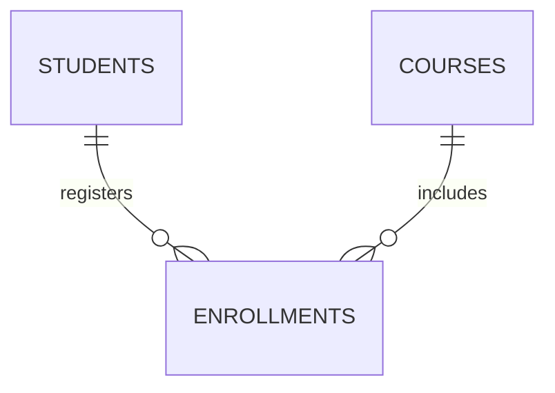

# 07 — Relationships

## الفكرة

العلاقة بتوصف ارتباط سجلات جدول بسجلات جدول تاني. شكل العلاقة بيتحدد حسب قواعد النظام اللي بنصمّمه، مش حسب أسماء الجداول وحدها.

## المفاتيح أولًا

| المصطلح | المعنى |
| --- | --- |
| Primary Key — PK | عمود أو مجموعة أعمدة بتميّز كل صف؛ القيم فريدة وغير NULL |
| Foreign Key — FK | عمود أو مجموعة أعمدة بتشير لمفتاح مرجعي في جدول آخر أو نفس الجدول |
| UNIQUE | يمنع تكرار القيم وفق قواعد القيد |
| NOT NULL | يمنع غياب القيمة |

في الأمثلة هنربط FK بـPK. وجود نفس اسم العمود في جدولين مش كفاية لإنشاء قيد علاقة.

## 1. One-to-Many — قسم وموظفون

نفترض إن كل موظف لازم ينتمي لقسم واحد، والقسم ممكن يضم صفر أو أكثر من الموظفين.

المثال هنا تعليمي مستقل عن جدول الموظفين في الصور؛ مفيش department_id ظاهر في بياناتنا الأصلية.

### كود التصميم في قاعدة تدريب منفصلة

```sql
CREATE TABLE demo_departments (
    department_id INTEGER PRIMARY KEY,
    department_name TEXT NOT NULL
);

CREATE TABLE demo_employees (
    id INTEGER PRIMARY KEY,
    first_name TEXT NOT NULL,
    department_id INTEGER NOT NULL REFERENCES demo_departments(department_id)
);
```

### النتيجة المتوقعة من التصميم

لو قسم IT رقمه 10 موجود، ممكن موظفان مختلفان يكون عندهم department_id = 10. الـFK موجودة في ناحية many، وبتمنع رقم قسم غير موجود؛ NOT NULL بتلزم الموظف بقسم. ده مش بيلزم كل قسم بوجود موظفين.

الأسماء demo_ عشان المثال يبقى منفصل عن جدولنا الأصلي؛ مش مطلوب تضيف الأعمدة أوالجداول دي لبياناتك لتشغيل دروس الفلترة.

## 2. One-to-One — مستخدم وملف شخصي

نفترض إن المستخدم له ملف شخصي واحد كحد أقصى، وكل ملف يخص مستخدمًا واحدًا.

```sql
CREATE TABLE users (
    user_id INTEGER PRIMARY KEY,
    username TEXT NOT NULL UNIQUE
);

CREATE TABLE profiles (
    user_id INTEGER PRIMARY KEY REFERENCES users(user_id),
    bio TEXT
);
```

استخدمنا `profiles.user_id` كمفتاح أساسي وخارجي معًا. المفتاح الأساسي يمنع إنشاء ملفين لنفس المستخدم، والمفتاح الخارجي يمنع ملف لمستخدم غير موجود.

### مثال للنتيجة المتوقعة من التصميم

| users.user_id | username | profiles.user_id | bio |
| --- | --- | --- | --- |
| 1 | abdo | 1 | Learning SQL |

ده توضيح للعلاقة، مش بيانات مضافة تلقائيًا بالكود السابق. إدخال profile ثانية بنفس user_id هيرفضه PK.

التصميم يسمح بمستخدم بدون profile؛ لو النظام يشترط وجودها دائمًا، FK وحدها مش كفاية لفرض ده من الاتجاهين.

## 3. Many-to-Many — طلاب وكورسات

الطالب ممكن يسجل في كورسات متعددة، والكورس ممكن يسجل فيه طلاب متعددون. بنستخدم جدول وسيط (Junction Table):

```sql
CREATE TABLE students (
    student_id INTEGER PRIMARY KEY,
    student_name TEXT NOT NULL
);

CREATE TABLE courses (
    course_id INTEGER PRIMARY KEY,
    course_name TEXT NOT NULL
);

CREATE TABLE enrollments (
    student_id INTEGER REFERENCES students(student_id),
    course_id INTEGER REFERENCES courses(course_id),
    PRIMARY KEY (student_id, course_id)
);
```

### مثال لبيانات الجدول الوسيط

| student_id | course_id |
| --- | --- |
| 1 | 101 |
| 1 | 102 |
| 2 | 101 |

نفترض إن الطلاب والكورسات المشار إليهم موجودين في جدوليهم. الطالب 1 في كورسين، والكورس 101 فيه طالبان.

المفتاح الأساسي المركّب يمنع تكرار **نفس زوج الطالب والكورس**؛ لكنه يسمح بتكرار الطالب مع كورس مختلف والعكس. ممكن نضيف بيانات تخص التسجيل نفسه زي `enrolled_at`.



كل صف تسجيل مرتبط بطالب واحد وكورس واحد. كل طالب أو كورس ممكن يكون له صفر أو أكثر من التسجيلات.

## أخطاء شائعة

- FK لوحدها مش بتحوّل العلاقة لـone-to-one؛ لازم قيد يمنع تكرار المفتاح في الناحية التابعة، زي PK أوUNIQUE المناسب.
- ما نحطّش أرقام كورسات متعددة كنص مفصول بفواصل داخل عمود الطالب؛ الجدول الوسيط بينظم كل ارتباط كصف.
- وجود علاقة مش معناه إن البيانات من الجدولين هتظهر تلقائيًا في SELECT؛ جمع الأعمدة من جداول مختلفة موضوع JOIN لاحقًا.
- سلوك حذف سجل له سجلات مرتبطة بيعتمد على إعداد قيد FK؛ ما تفترضش إن السجلات التابعة بتتحذف تلقائيًا.

---

[الفهرس](../README.md) · [بيانات الأمثلة](00-sample-data.md) · [السابق](06-logical-processing-order.md)
